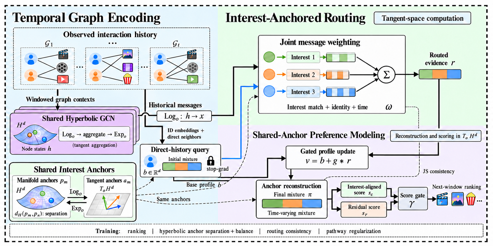

# I-STHD

**Interest-Anchored Spatio-Temporal Hyperbolic Disentanglement** for recommendation on evolving user–item graphs.

I-STHD uses one shared interest-anchor bank to connect historical message selection with preference modeling after aggregation. Users share the interest coordinates while their mixtures change as new observations arrive.



## Method

1. **Encode observed graph contexts.** Build a finite-window interaction graph at each historical cutoff. A shared graph encoder summarizes its multi-hop collaborative neighborhoods.
2. **Construct an independent interest query.** Pool user identity and directly observed item embeddings, without graph propagation. Match this base profile to the anchors, then detach the initial mixture before passing it to the router.
3. **Route historical evidence.** Jointly weight neighbor–time–interest combinations using the initial mixture, anchor alignment, user–item identity compatibility, and two time ages. A historical item can contribute its updated collaborative context even when the user has no new interaction.
4. **Update and reorganize preferences.** Gate routed evidence into the base profile. Reuse the same anchors to estimate the final mixture, reconstruct its interest-aligned component, and retain the unexplained residual. A within-origin JS objective connects routed interest masses with the final mixture.
5. **Rank the next window.** Both components score the same user-conditioned item-factor representation. A learned gate combines the two scores, so useful information outside the anchor reconstruction can contribute at inference.

The initial mixture, routed interest masses, and final mixture are computed separately. Shared anchors do not force users' interest proportions to stay constant. The residual is not assumed to contain only noise, and the soft reconstruction is not an orthogonal projection.

### Geometry

Node states and manifold anchors use the curvature-one Lorentz model. Routing, reconstruction, and scoring use origin-tangent coordinates; anchor separation uses hyperbolic distance. With the present fixed-origin aggregation formula, successive `Log(Exp(...))` operations cancel in exact arithmetic, so the encoder's tangent output equals the corresponding Euclidean GCN. The hyperbolic metric acts through anchor separation. See [geometry and equations](docs/method.md) for the exact distinction.

## Install

Python 3.10+ and PyTorch 2.2+ are required. The implementation does not require PyTorch Geometric, SciPy, or a graph server.

```bash
python -m venv .venv
source .venv/bin/activate
python -m pip install -e '.[dev]'
```

## Run an end-to-end example

```bash
python -m isthd.train --demo --config configs/smoke.json --epochs 2 --output runs/demo
python -m isthd.evaluate --checkpoint runs/demo/checkpoint.pt --demo
python -m pytest -q
```

The demo generates a small synthetic temporal interaction dataset. Its metrics check execution, not real-world recommendation performance. Training writes `checkpoint.pt` and `metrics.json`; checkpoints retain model configuration, source ID mappings, time boundaries, and the best source-validation model.

## Use your data

Supply a UTF-8 CSV with this header:

```text
user_id,item_id,timestamp
u0,i0,1700000000
u1,i1,1700000100
```

Timestamps can be Unix seconds or ISO-8601 strings. All interactions are treated as implicit positive feedback. Keep timestamps in the same unit and use enough history for at least four windows.

```bash
python -m isthd.train \
  --data data/interactions.csv \
  --window-seconds 604800 \
  --train-fraction 0.6 --val-fraction 0.2 \
  --epochs 20 --batch-size 32 --num-negatives 8 \
  --dim 32 --anchors 4 --ks 10 20 \
  --output runs/experiment

python -m isthd.evaluate \
  --checkpoint runs/experiment/checkpoint.pt \
  --data data/interactions.csv --ks 10 20
```

`scripts/prepare_movielens.py` converts a local MovieLens ratings file to this format; inspect its `--help` for options. Datasets are not bundled or downloaded automatically.

## Temporal protocol

- Window zero supplies initial history; later target windows are partitioned chronologically into source training, validation, and test.
- User/item vocabularies are fitted on source training windows. Target-only IDs are excluded and counted.
- At cutoff `t`, the model accepts only snapshots `0..t`. Labels from `t+1` supply supervision or evaluation, never graph input.
- The candidate universe consists of source-vocabulary items observed by `t`, excluding that user's previous interactions. New, not-yet-visible items and repeated positives are counted separately.
- Training negatives exclude the current next-window positives. Later labels do not affect negative sampling.
- Validation selects the checkpoint; test labels are consulted after selection. Frozen rolling evaluation admits newly observed edges without updating parameters.
- Recall and NDCG use the full eligible candidate set, with deterministic tie-breaking. Cold-start and coverage exclusions accompany the metrics.

The default forward pass recomputes graph states for each batch, so training never reuses states produced by an older parameter version. This prioritizes a clear computation boundary; large-scale caching and distributed training are not implemented.

## Code map

| File | Purpose |
|---|---|
| `src/isthd/geometry.py` | Lorentz exponential/log maps, distances, radius constraints |
| `src/isthd/model.py` | Shared encoder, query, joint router, reconstruction, factor heads and score gates |
| `src/isthd/loss.py` | Serving-score BPR, common/seed supervision and regularization |
| `src/isthd/data.py` | Timestamp windows, source vocabularies, history-only candidates and sampling |
| `src/isthd/train.py` | Source training, validation selection, checkpoint and metrics |
| `src/isthd/evaluate.py` | Frozen rolling Recall/NDCG evaluation |
| `tests/` | Geometry, gradient, chronology and scoring invariants |

Configuration examples are in `configs/`. No trained weights or benchmark results are included.

